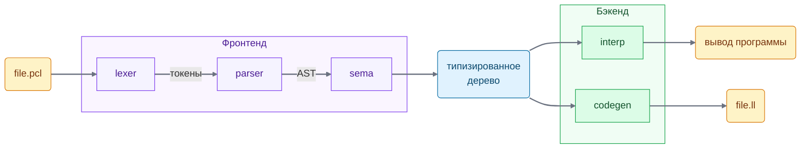
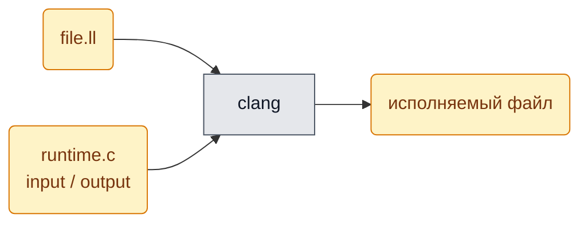
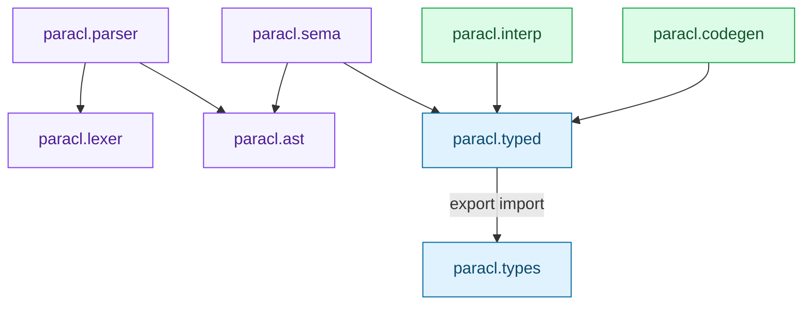
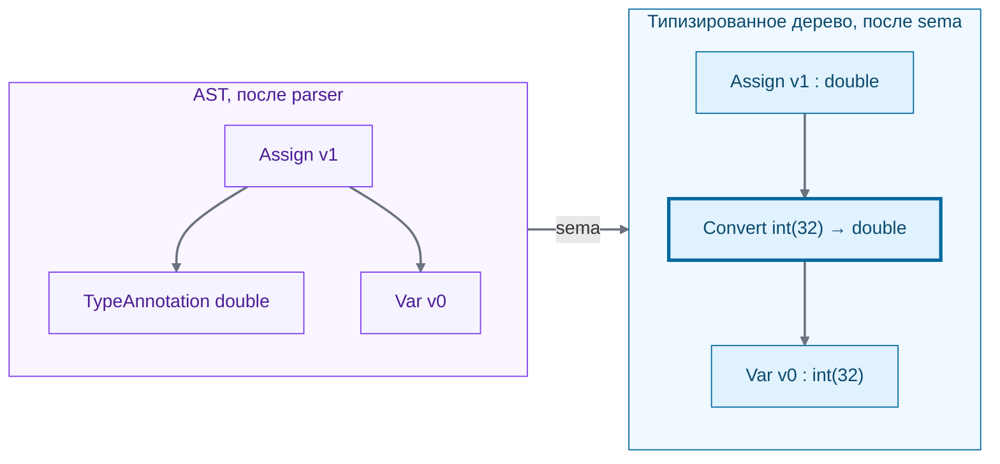
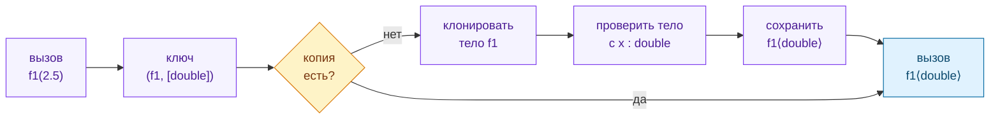

# Архитектура компилятора ParaCL

Как устроен компилятор: из каких частей он состоит, что между ними передаётся и
кто от кого зависит. Почему устроено именно так — в [decisions.md](decisions.md);
вопросы к самому языку — в [language.md](language.md).

> **Статус: черновик.** Схема опирается на принятые решения 1–4. Отдельное
> типизированное дерево (`paracl.typed`, раздел 3) пока только предложено, выбор
> бэкенда отложен (решение 5).

Цвета во всех схемах одинаковые:
🟪 фронтенд · 🟦 граница между фронтендом и бэкендом · 🟩 бэкенд ·
🟨 файлы и данные · ⬜ внешние инструменты.

---

## 1. Конвейер: что во что превращается

Компилятор — это цепочка стадий. Каждая стадия берёт результат предыдущей и
превращает его в следующее представление программы.



| Стадия | Вход | Выход | Что делает |
|---|---|---|---|
| **lexer** | текст | токены | режет текст на слова языка: `v0`, `:`, `int`, `=`, `5`, `;` |
| **parser** | токены | AST | строит дерево по грамматике, проверяет синтаксис |
| **sema** | AST | типизированное дерево | разрешает имена, выводит и проверяет типы, раскрывает generic-функции |
| **interp** | типизированное дерево | вывод программы | исполняет дерево, рекурсивно обходя его |
| **codegen** | типизированное дерево | `file.ll` | печатает LLVM IR (текстовый промежуточный язык LLVM) |

- **AST** (abstract syntax tree) — дерево программы в том виде, как её написал
  пользователь: без типов, generic-функции ещё не раскрыты.
- **sema** (semantic analysis) — смысловой анализ: всё, что можно проверить до
  запуска.
- **Бэкенд** — последняя стадия, `interp` или `codegen`. Какой из них (или оба)
  будем делать, пока не решено.

Стадиями управляет **driver** (`main.cpp`): разбирает аргументы командной строки,
читает файл, по очереди вызывает стадии и печатает ошибки.

### Если выберем IR: как получить исполняемый файл

`codegen` выдаёт только текст `file.ll`. Исполняемый файл из него собирает `clang`,
дописывая маленький **runtime** — файл на C с функциями ввода/вывода, которые
вызывает сгенерированный код.



---

## 2. Модули и их зависимости

Конвейер выше показывает, **как текут данные**. Модули C++ описывают другое:
**кто кого импортирует**. Стрелка `A → B` означает `A` делает `import B`.



🟪 фронтенд · 🟦 граница · 🟩 бэкенд.

На схеме не показаны два модуля, чтобы не загромождать её:
- `paracl.diag` (позиции в исходнике и сообщения об ошибках) импортируют `lexer`,
  `ast`, `typed` и driver;
- driver импортирует `parser`, `sema`, `interp` и `codegen`.

| Модуль | Что внутри | Импортирует |
|---|---|---|
| `paracl.diag` | позиция в исходнике (файл:строка:столбец), сообщения об ошибках | — |
| `paracl.lexer` | текст → токены | `diag` |
| `paracl.ast` | узлы AST, дамп дерева для тестов | `diag` |
| `paracl.parser` | токены → AST | `lexer`, `ast` |
| `paracl.types` | представление типов: `int(N)`, `double`, массив, структура, тип функции | — |
| `paracl.typed` | узлы типизированного дерева | `diag`, `export import types` |
| `paracl.sema` | AST → типизированное дерево | `ast`, `typed` |
| `paracl.interp` | исполнение типизированного дерева | `typed` |
| `paracl.codegen` | типизированное дерево → `.ll` | `typed` |

**Почему схема такая.**

- **Граф без циклов.** Модули не могут импортировать друг друга по кругу (лекция,
  слайд 56). Все стрелки идут сверху вниз, ни одна не возвращается.
- **Фронтенд и бэкенд не знают друг о друге.** Оба смотрят только на границу. Среди
  импортов `interp` и `codegen` нет ни `ast`, ни `parser`: если бэкенд попытается
  заглянуть в нетипизированное дерево, код не скомпилируется. Аналогия с C:
  функцию из заголовка, который не подключён, вызвать нельзя. Граница из решения 5
  охраняется компилятором, а не договорённостью.
- **`export import types` внутри `typed`** (предложено). Транзитивный импорт (лекция,
  слайд 50): кто импортирует `typed`, автоматически получает и `types`. Узлы
  дерева всё равно бесполезны без типов, поэтому отдельный `import paracl.types` в
  каждом бэкенде был бы лишним.
- **`types` отдельно от `typed`.** Сами типы не должны знать о деревьях. Например,
  `paracl.types` не хранит указатель на тело функции, иначе появится цикл
  `types ↔ typed`.

Точка в `paracl.lexer` — просто часть имени, для языка никакой вложенности она не
означает. Настоящее деление модуля на части — **partitions** (разделы), они пишутся
через двоеточие: `paracl.sema:generics`. Разделы пригодятся, когда `sema` вырастет.

---

## 3. Граница: типизированное дерево

### 3.1. Что меняет sema

Пример из [decisions.md](decisions.md), решение 3:

```pcl
v0 = 0;
v1 : double = v0;
```



- У каждого узла появился конкретный тип.
- Неявное преобразование `int → double` стало явным узлом `Convert` (выделен
  жирной рамкой).
- Аннотация `: double` исчезла как отдельный узел: она нужна была только sema.

### 3.2. Что гарантирует граница

Если программа дошла до бэкенда:

1. У каждого выражения есть конкретный тип: `int(16)`, а не «какой-то int».
2. Все неявные преобразования — явные узлы `Convert`.
3. Каждый вызов указывает на конкретную функцию без generic-параметров.
4. Ошибок типов в программе нет.

### 3.3. Как sema раскрывает generic-функции

```pcl
f1 : (x) = { v3 = x + 1; v3 * v3; };
a = f1(2);
b = f1(2.5);
```



В типизированное дерево попадают только копии `f1⟨int⟩` и `f1⟨double⟩`. Узла
«generic-функция» там нет.

### 3.4. Развилка: отдельное дерево или то же AST

**Статус:** открыто (склоняемся к варианту B)

| | A. Аннотировать то же AST | B. Отдельное дерево `paracl.typed` |
|---|---|---|
| Как | в узлах AST есть поле `type`, sema его заполняет | sema строит новое дерево из других узлов |
| Плюс | одна иерархия узлов, меньше кода | гарантии видны в типах C++: поле типа не может быть пустым, узла generic-функции просто нет |
| Минус | бэкенд получает дерево, где `type` может быть пустым, а generic-узлы существуют. Гарантии держатся на честном слове | два набора узлов, sema переливает одно в другое |

Аналогия с C: в варианте A в структуре есть указатель, который «после такой-то
стадии точно не NULL». В варианте B это другая структура, где такого указателя нет.

Схема модулей в разделе 2 нарисована для варианта B. При варианте A модуль
`paracl.typed` исчезает, и бэкенд импортирует `paracl.ast`.

---

## 4. Тесты по слоям

Каждую стадию можно тестировать отдельно, не дожидаясь остальных.

| Стадия | Вид теста | Что проверяет |
|---|---|---|
| lexer | юнит-тест | текст → ожидаемая последовательность токенов |
| parser | golden-тест | дамп AST совпадает с сохранённым эталоном |
| sema | ill-formed тест | неправильная программа отвергается с ожидаемой ошибкой |
| interp / codegen | end-to-end | `.pcl` + `.in` → вывод совпадает с `.out` |
| interp + codegen | дифференциальный | оба бэкенда дают одинаковый вывод на одной программе |

- **Golden-тест** — сравнение вывода с заранее сохранённым правильным файлом.
- **Ill-formed тест** — программа, которую компилятор обязан отвергнуть. Тест
  проверяет, что ошибка есть и что она та самая (категории — в
  [language.md](language.md), раздел 0).
- **Дифференциальный тест** имеет смысл, только если будут оба бэкенда.

---

## Открытые вопросы

- [ ] Вариант A или B для типизированного дерева (раздел 3.4).
- [ ] `export import paracl.types` внутри `paracl.typed` (раздел 2).
- [ ] `paracl.diag`: останавливаться на первой ошибке или собирать все?
- [ ] Выбор бэкенда ([decisions.md](decisions.md), решение 5).

---

*Draft prepared with help of Claude.*
